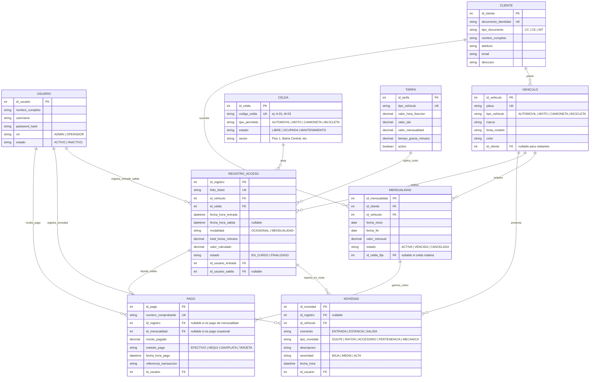

# Entregable 5: Modelado de Datos (MER, MR y Modelo Físico)
## Parqueadero "Autos Colombia" - Iteración 1

---

### 1. Modelo Entidad-Relación (MER - Conceptual)

El modelo conceptual captura las entidades del negocio, sus atributos esenciales y las relaciones con sus cardinalidades:

---

### 2. Modelo Relacional (MR - Esquema Normalizado 3FN)

El diseño relacional cumple rigurosamente con la **Tercera Forma Normal (3FN)**:
1. **1FN**: Todos los atributos son atómicos y no existen grupos repetitivos.
2. **2FN**: Todos los atributos no clave tienen dependencia funcional completa de la clave primaria.
3. **3FN**: No existen dependencias transitivas entre atributos no clave.

#### Esquema de Tablas y Claves

1. **`usuarios`**
   * **PK:** `id_usuario` (INT, AUTO_INCREMENT)
   * `nombre_completo` (VARCHAR(100), NOT NULL)
   * `username` (VARCHAR(50), UNIQUE, NOT NULL)
   * `password_hash` (VARCHAR(255), NOT NULL)
   * `rol` (VARCHAR(20), CHECK in ('ADMIN', 'OPERADOR'), NOT NULL)
   * `activo` (BOOLEAN, DEFAULT TRUE)
   * `fecha_creacion` (DATETIME, DEFAULT CURRENT_TIMESTAMP)

2. **`clientes`**
   * **PK:** `id_cliente` (INT, AUTO_INCREMENT)
   * `documento` (VARCHAR(20), UNIQUE, NOT NULL)
   * `tipo_documento` (VARCHAR(10), DEFAULT 'CC')
   * `nombre_completo` (VARCHAR(120), NOT NULL)
   * `telefono` (VARCHAR(20), NOT NULL)
   * `email` (VARCHAR(100))
   * `direccion` (VARCHAR(150))
   * `fecha_registro` (DATETIME, DEFAULT CURRENT_TIMESTAMP)

3. **`vehiculos`**
   * **PK:** `id_vehiculo` (INT, AUTO_INCREMENT)
   * `placa` (VARCHAR(10), UNIQUE, NOT NULL)
   * `tipo_vehiculo` (VARCHAR(20), CHECK in ('AUTOMOVIL', 'MOTO', 'CAMIONETA', 'BICICLETA'), NOT NULL)
   * `marca` (VARCHAR(50))
   * `modelo` (VARCHAR(50))
   * `color` (VARCHAR(30))
   * `id_cliente` (INT, NULL, **FK** -> `clientes(id_cliente)`)
   * `fecha_creacion` (DATETIME, DEFAULT CURRENT_TIMESTAMP)

4. **`celdas`**
   * **PK:** `id_celda` (INT, AUTO_INCREMENT)
   * `codigo_celda` (VARCHAR(10), UNIQUE, NOT NULL)
   * `tipo_permitido` (VARCHAR(20), NOT NULL)
   * `estado` (VARCHAR(20), CHECK in ('LIBRE', 'OCUPADA', 'MANTENIMIENTO'), DEFAULT 'LIBRE')
   * `sector` (VARCHAR(50), NOT NULL)

5. **`tarifas`**
   * **PK:** `id_tarifa` (INT, AUTO_INCREMENT)
   * `tipo_vehiculo` (VARCHAR(20), UNIQUE, NOT NULL)
   * `valor_hora_fraccion` (DECIMAL(10,2), NOT NULL)
   * `valor_dia` (DECIMAL(10,2), NOT NULL)
   * `valor_mensualidad` (DECIMAL(10,2), NOT NULL)
   * `tiempo_gracia_minutos` (INT, DEFAULT 10)
   * `activo` (BOOLEAN, DEFAULT TRUE)

6. **`mensualidades`**
   * **PK:** `id_mensualidad` (INT, AUTO_INCREMENT)
   * `id_cliente` (INT, NOT NULL, **FK** -> `clientes(id_cliente)`)
   * `id_vehiculo` (INT, NOT NULL, **FK** -> `vehiculos(id_vehiculo)`)
   * `id_celda_asignada` (INT, NULL, **FK** -> `celdas(id_celda)`)
   * `fecha_inicio` (DATE, NOT NULL)
   * `fecha_fin` (DATE, NOT NULL)
   * `valor_mensual` (DECIMAL(10,2), NOT NULL)
   * `estado` (VARCHAR(20), CHECK in ('ACTIVA', 'VENCIDA', 'CANCELADA'), DEFAULT 'ACTIVA')

7. **`registros_acceso`**
   * **PK:** `id_registro` (INT, AUTO_INCREMENT)
   * `folio_ticket` (VARCHAR(30), UNIQUE, NOT NULL)
   * `id_vehiculo` (INT, NOT NULL, **FK** -> `vehiculos(id_vehiculo)`)
   * `id_celda` (INT, NOT NULL, **FK** -> `celdas(id_celda)`)
   * `fecha_hora_entrada` (DATETIME, NOT NULL)
   * `fecha_hora_salida` (DATETIME, NULL)
   * `modalidad` (VARCHAR(20), CHECK in ('OCASIONAL', 'MENSUALIDAD'), NOT NULL)
   * `minutos_estancia` (INT, DEFAULT 0)
   * `valor_total` (DECIMAL(10,2), DEFAULT 0.00)
   * `estado` (VARCHAR(20), CHECK in ('EN_CURSO', 'FINALIZADO'), DEFAULT 'EN_CURSO')
   * `id_usuario_entrada` (INT, NOT NULL, **FK** -> `usuarios(id_usuario)`)
   * `id_usuario_salida` (INT, NULL, **FK** -> `usuarios(id_usuario)`)

8. **`novedades`**
   * **PK:** `id_novedad` (INT, AUTO_INCREMENT)
   * `id_registro` (INT, NULL, **FK** -> `registros_acceso(id_registro)`)
   * `id_vehiculo` (INT, NOT NULL, **FK** -> `vehiculos(id_vehiculo)`)
   * `momento` (VARCHAR(20), CHECK in ('ENTRADA', 'ESTANCIA', 'SALIDA'), NOT NULL)
   * `tipo_novedad` (VARCHAR(30), NOT NULL)
   * `descripcion` (TEXT, NOT NULL)
   * `severidad` (VARCHAR(20), CHECK in ('BAJA', 'MEDIA', 'ALTA'), DEFAULT 'BAJA')
   * `fecha_hora` (DATETIME, DEFAULT CURRENT_TIMESTAMP)
   * `id_usuario` (INT, NOT NULL, **FK** -> `usuarios(id_usuario)`)

9. **`pagos`**
   * **PK:** `id_pago` (INT, AUTO_INCREMENT)
   * `numero_comprobante` (VARCHAR(30), UNIQUE, NOT NULL)
   * `id_registro` (INT, NULL, **FK** -> `registros_acceso(id_registro)`)
   * `id_mensualidad` (INT, NULL, **FK** -> `mensualidades(id_mensualidad)`)
   * `monto_pagado` (DECIMAL(10,2), NOT NULL)
   * `metodo_pago` (VARCHAR(30), CHECK in ('EFECTIVO', 'NEQUI', 'DAVIPLATA', 'TARJETA'), NOT NULL)
   * `referencia_transaccion` (VARCHAR(60), NULL)
   * `fecha_hora_pago` (DATETIME, DEFAULT CURRENT_TIMESTAMP)
   * `id_usuario` (INT, NOT NULL, **FK** -> `usuarios(id_usuario)`)
