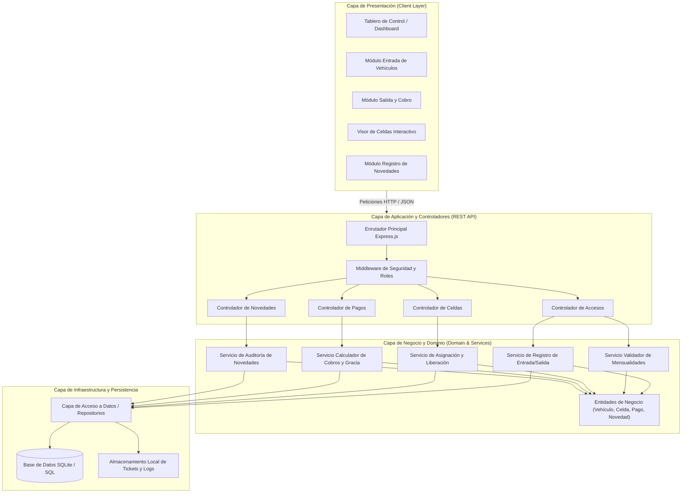
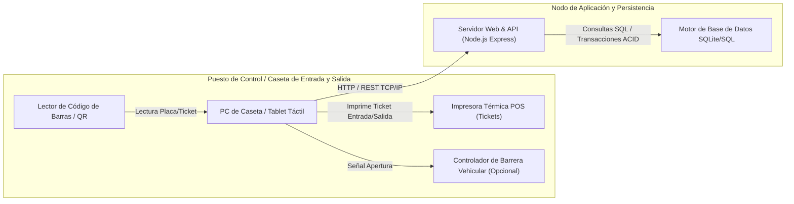

# Entregable 3: Arquitectura del Sistema (STARUML)
## Parqueadero "Autos Colombia" - Iteración 1

---

### 1. Enfoque Arquitectónico

Para el sistema de información del parqueadero **Autos Colombia**, se seleccionó una **Arquitectura en Capas (Layered / N-Tier Architecture)** basada en principios de diseño limpio (*Clean Architecture*) y separación de responsabilidades (*Separation of Concerns*).

Este patrón arquitectónico garantiza:
- **Desacoplamiento:** Las vistas y componentes de usuario no interactúan directamente con la base de datos.
- **Mantenibilidad:** Las reglas de liquidación tarifaria y validación de mensualidades residen en una capa de servicios aislada.
- **Escalabilidad:** Permite migrar fácilmente de un motor local (SQLite) a motores cliente-servidor corporativos (PostgreSQL/MySQL) o incorporar lecturas automatizadas (cámaras LPR de reconocimiento de matrículas o talanqueras electrónicas).

---

### 2. Diagrama de Arquitectura del Sistema



---

### 3. Diagrama de Despliegue de Hardware y Nodos Físicos



---

### 4. Código Fuente PlantUML del Diagrama de Arquitectura

El siguiente código fuente PlantUML puede compilarse directamente en StarUML o herramientas UML compatibles:

```plantuml
@startuml Arquitectura_Autos_Colombia
!theme plain
skinparam componentStyle rectangle

package "Capa de Presentación (Web UI)" {
    [Dashboard Operativo] as UI_Dash
    [Módulo de Entrada] as UI_Entrada
    [Módulo de Salida] as UI_Salida
    [Gestión de Celdas] as UI_Celdas
    [Registro de Novedades] as UI_Novedades
}

package "Capa de Controladores y API (REST)" {
    [AccesoController] as C_Acceso
    [CeldaController] as C_Celda
    [PagoController] as C_Pago
    [NovedadController] as C_Novedad
}

package "Capa de Servicios de Negocio" {
    [AccesoService] as S_Acceso
    [MensualidadService] as S_Mensualidad
    [CeldaService] as S_Celda
    [TarifaService] as S_Tarifa
    [NovedadService] as S_Novedad
}

package "Capa de Dominio" {
    class Vehiculo
    class Celda
    class RegistroAcceso
    class Novedad
    class Tarifa
    class Pago
    class Mensualidad
}

package "Capa de Persistencia e Infraestructura" {
    [BaseDatosAdapter] as DB_Adapter
    database "SQLite / SQL Server" as DB
}

UI_Entrada --> C_Acceso
UI_Salida --> C_Acceso
UI_Salida --> C_Pago
UI_Celdas --> C_Celda
UI_Novedades --> C_Novedad

C_Acceso --> S_Acceso
C_Acceso --> S_Mensualidad
C_Celda --> S_Celda
C_Pago --> S_Tarifa
C_Novedad --> S_Novedad

S_Acceso ..> RegistroAcceso
S_Acceso ..> Vehiculo
S_Mensualidad ..> Mensualidad
S_Celda ..> Celda
S_Tarifa ..> Tarifa
S_Novedad ..> Novedad

S_Acceso --> DB_Adapter
S_Celda --> DB_Adapter
S_Tarifa --> DB_Adapter
S_Novedad --> DB_Adapter
DB_Adapter --> DB
@enduml
```
