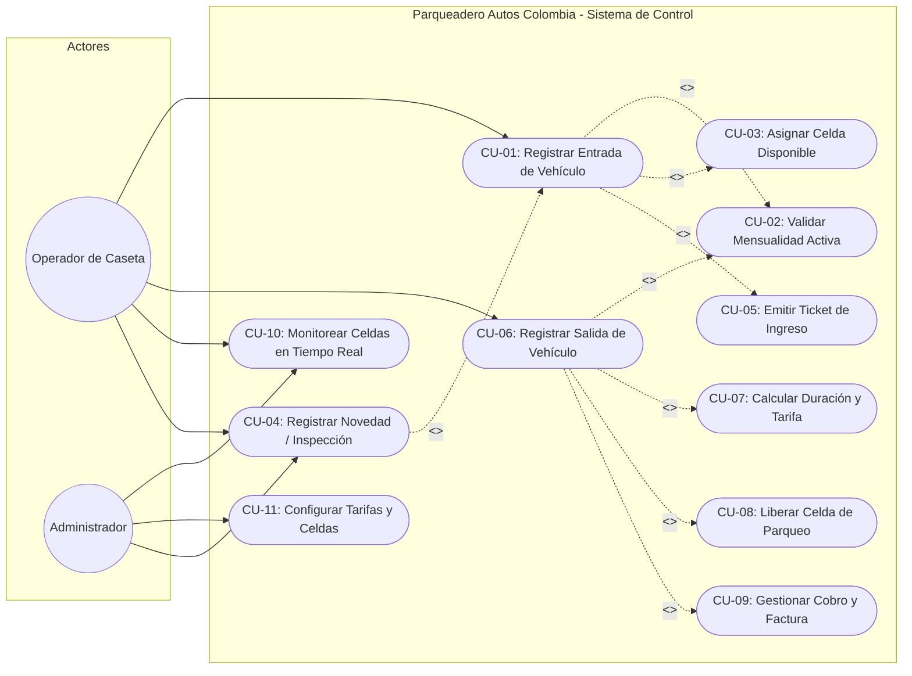
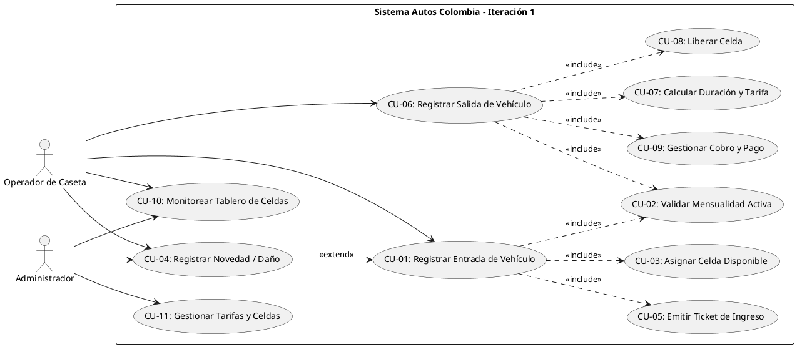

# Entregable 6: Diagramas de Casos de Uso (STARUML)
## Parqueadero "Autos Colombia" - Iteración 1

---

### 1. Actores del Sistema

1. **Operador de Parqueadero (Actor Principal):** Responsable de registrar las entradas y salidas de vehículos, verificar el estado de las mensualidades, inspeccionar daños para registrar novedades y cobrar las tarifas liquidadas en la caseta.
2. **Administrador del Sistema (Actor Secundario / Gestión):** Supervisa el funcionamiento operativo, configura tarifas, gestiona las cuentas de usuarios, administra el inventario de celdas y audita los reportes de novedades e ingresos.
3. **Cliente / Abonado (Actor Externo):** Conductor o propietario del vehículo que solicita el servicio ocasional o cuenta con una mensualidad activa.

---

### 2. Diagrama de Casos de Uso

---

### 3. Ficha de Especificación Detallada: CU-01 Registrar Entrada

| Atributo | Detalle |
| :--- | :--- |
| **Identificador** | **CU-01** |
| **Nombre** | **Registrar Entrada de Vehículo** |
| **Actor Principal** | Operador de Parqueadero |
| **Propósito** | Registrar el acceso formal del vehículo al parqueadero, asignando celda y emitiendo comprobante. |
| **Precondiciones** | 1. El operador ha iniciado sesión en el sistema. 2. Existen celdas libres para el tipo de vehículo a ingresar. |
| **Disparador** | Un vehículo llega a la barrera/caseta de ingreso de "Autos Colombia". |
| **Flujo Principal (Happy Path)** | 1. El operador ingresa la placa del vehículo. 2. El sistema valida si el vehículo cuenta con mensualidad activa (**CU-02**). 3. El operador confirma el tipo de vehículo (Automóvil, Moto, Camioneta, Bici). 4. El sistema busca y asigna automáticamente una celda libre del tipo requerido (**CU-03**). 5. La celda cambia a estado "OCUPADA". 6. El sistema crea el registro de acceso con fecha y hora actual. 7. El sistema emite e imprime el ticket de entrada con folio y código QR (**CU-05**). |
| **Flujos Alternos** | **3a. Vehículo con daños visibles o pertenencias:** El operador ejecuta la extensión **CU-04 (Registrar Novedad)**, redactando la observación antes de emitir el ticket. **4a. No hay celdas libres:** El sistema notifica al operador que el parqueadero está lleno para ese tipo de vehículo. El proceso se cancela sin generar registro. **1a. Placa ya registrada con entrada activa:** El sistema alerta que el vehículo ya se encuentra adentro del parqueadero y rechaza el registro. |
| **Postcondiciones** | Se crea el registro de entrada, se decrementa la disponibilidad de celdas y se genera el ticket. |

---

### 4. Ficha de Especificación Detallada: CU-06 Registrar Salida

| Atributo | Detalle |
| :--- | :--- |
| **Identificador** | **CU-06** |
| **Nombre** | **Registrar Salida de Vehículo y Liquidación** |
| **Actor Principal** | Operador de Parqueadero |
| **Propósito** | Registrar el egreso del vehículo, calcular el cobro según tiempo de permanencia, registrar el pago y liberar la celda. |
| **Precondiciones** | El vehículo debe tener un registro de acceso en estado "EN_CURSO". |
| **Disparador** | El conductor se presenta en la caseta de salida. |
| **Flujo Principal** | 1. El operador digita la placa del vehículo o escanea el folio del ticket. 2. El sistema recupera el registro de acceso y valida si tiene mensualidad activa (**CU-02**). 3. El sistema calcula los minutos transcurridos y liquida la tarifa según la categoría (**CU-07**). 4. El operador solicita el importe al cliente y selecciona el medio de pago (Efectivo/Transferencia). 5. El sistema registra el pago y emite el comprobante de salida (**CU-09**). 6. El sistema actualiza el registro a estado "FINALIZADO". 7. La celda asignada cambia inmediatamente a estado "LIBRE" (**CU-08**). |
| **Flujos Alternos** | **2a. Vehículo amparado por mensualidad vigente:** El sistema liquida valor a pagar en $0 COP con motivo "Mensualidad Vigente". Se emite comprobante de salida sin cobro de fracción. **3a. Estancia dentro del tiempo de gracia (<= 15 min):** Si el vehículo estuvo menos del tiempo de gracia reglamentario, el cobro es $0 COP. |
| **Postcondiciones** | Celda liberada, pago registrado en caja y registro de acceso cerrado. |

---

### 5. Archivo PlantUML de Casos de Uso

