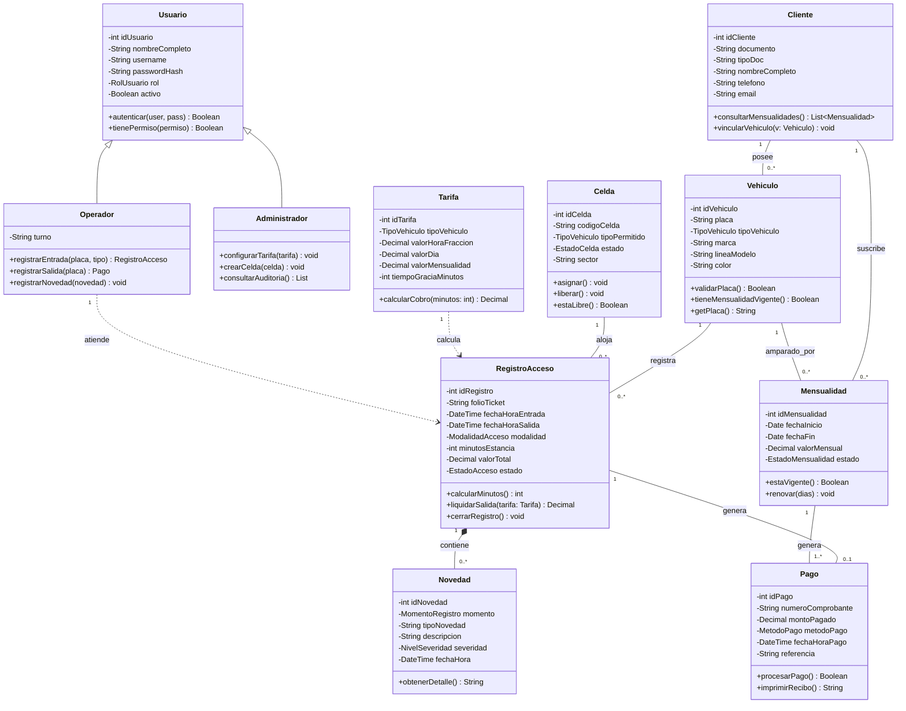
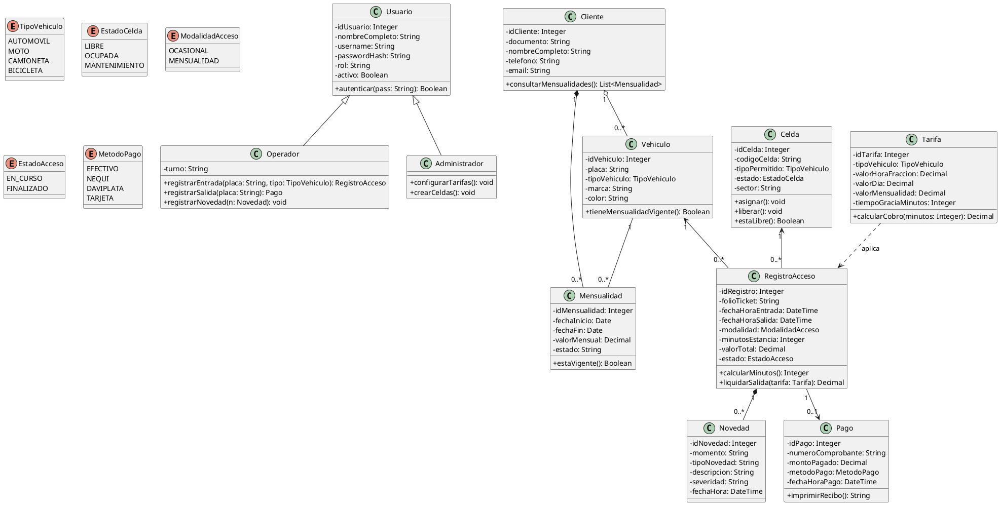

# Entregable 7: Diagrama de Clases (STARUML)
## Parqueadero "Autos Colombia" - Iteración 1

---

### 1. Descripción de Clases del Dominio y Responsabilidades

1. **`Vehiculo`**: Representa la unidad móvil que ingresa al parqueadero. Contiene la placa (identificador único natural), tipo de vehículo, marca, color y referencia al cliente si está registrado como abonado.
2. **`Celda`**: Representa el espacio físico delimitado donde se estaciona el automotor. Mantiene el estado en tiempo real (LIBRE, OCUPADA, MANTENIMIENTO) y el tipo de vehículo para el cual está dimensionada.
3. **`RegistroAcceso`**: Es la entidad transaccional central que registra la estancia de un vehículo, calculando la fecha/hora de entrada, fecha/hora de salida, duración en minutos y liquidación del valor.
4. **`Novedad`**: Registra cualquier daño físico previo (rayones, golpes, accesorios faltantes) o incidente reportado durante la estadía para deslinde de responsabilidades legales.
5. **`Cliente`**: Propietario o conductor recurrente suscrito al servicio de mensualidad.
6. **`Mensualidad`**: Suscripción temporal (generalmente 30 días) que ampara a un vehículo para ingresar sin generar cobro por minutos.
7. **`Tarifa`**: Define los costos de hora/fracción, día y mensualidad según la tipología del automotor.
8. **`Pago`**: Representa la transacción económica de salida o renovación de mensualidad, con medio de pago y folio fiscal.
9. **`Usuario` / `Operador`**: Usuario del sistema con credenciales de acceso y permisos operativos.

---

### 2. Diagrama de Clases UML

---

### 3. Código Fuente PlantUML del Diagrama de Clases

