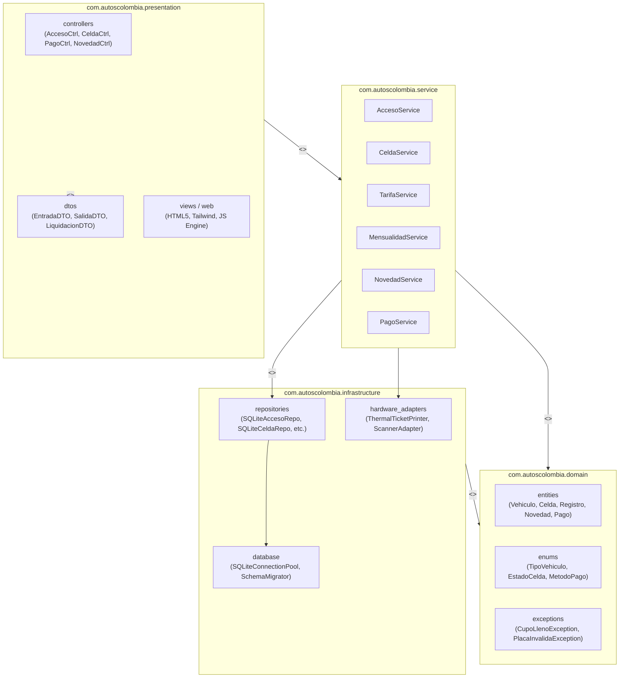
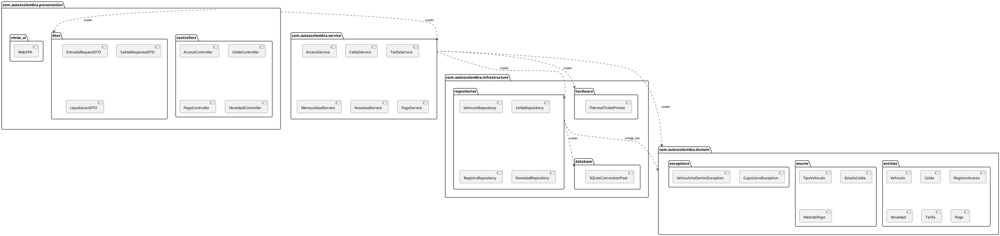

# Entregable 8: Diagrama de Paquetes (STARUML)
## Parqueadero "Autos Colombia" - Iteración 1

---

### 1. Organización Modular de Paquetes

La descomposición en paquetes del sistema **Autos Colombia** sigue el estándar de diseño por capas y componentes modulares, agrupados bajo el espacio de nombres corporativo:

```
com.autoscolombia/
├── presentation/         (Capa de Interfaz de Usuario y Controladores Web)
│   ├── controllers/
│   ├── dtos/
│   └── views/
├── service/              (Capa de Aplicación y Lógica de Negocio)
│   ├── interfaces/
│   └── implementations/
├── domain/               (Capa de Negocio Puro y Entidades)
│   ├── entities/
│   ├── enums/
│   └── exceptions/
└── infrastructure/       (Capa de Persistencia, Conectores y Hardware)
    ├── database/
    ├── repositories/
    └── hardware_adapters/
```

---

### 2. Diagrama de Paquetes UML



---

### 3. Matriz de Dependencias y Reglas de Arquitectura

1. **Dirección Unidireccional:** Las dependencias van de las capas superiores a las inferiores (`Presentation` -> `Service` -> `Domain` & `Infrastructure`). No existen dependencias circulares.
2. **Independencia del Dominio:** El paquete `domain` no tiene dependencias de bibliotecas de base de datos ni de frameworks web, permitiendo que las reglas de negocio sean portables y testables de forma aislada.
3. **Inversión de Dependencias (DIP):** Los servicios de la aplicación interactúan con contratos e interfaces de repositorios que la infraestructura implementa.

---

### 4. Código Fuente PlantUML del Diagrama de Paquetes


