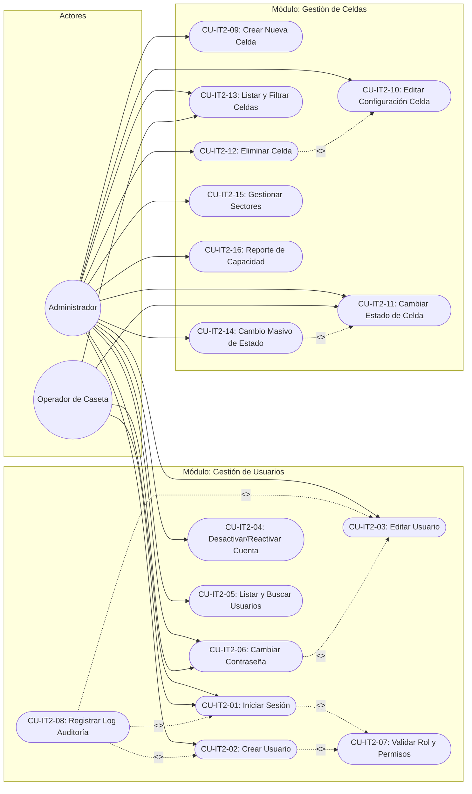

# Entregable 6: Diagrama de Casos de Uso (STARUML)
## Parqueadero "Autos Colombia" — Iteración 2: Gestión de Usuarios y Gestión de Celdas

---

### 1. Actores del Sistema — Iteración 2

| # | Actor | Descripción | Tipo |
| :--- | :--- | :--- | :--- |
| 1 | **Administrador del Sistema** | Usuario con rol `ADMIN` que tiene acceso completo a todos los módulos del sistema: gestión de usuarios (CRUD, activación/desactivación), gestión de celdas (CRUD, sectores, mantenimiento), configuración de tarifas y generación de reportes. | Principal |
| 2 | **Operador de Caseta** | Usuario con rol `OPERADOR` que tiene acceso limitado a las operaciones de caseta (entrada/salida de vehículos de Iteración 1), consulta de celdas, cambio de su propia contraseña y cambio de estado de celdas entre LIBRE y MANTENIMIENTO. | Principal |
| 3 | **Sistema (Interno)** | Componente automático que ejecuta las validaciones de roles (RBAC), el registro de auditoría y las restricciones de integridad. | De soporte |

---

### 2. Diagrama de Casos de Uso — Iteración 2

---

### 3. Listado de Casos de Uso — Iteración 2

#### 3.1. Módulo de Gestión de Usuarios

| ID | Caso de Uso | Descripción | Actor(es) |
| :--- | :--- | :--- | :--- |
| CU-IT2-01 | Iniciar Sesión | Autenticación del usuario con username/contraseña, creación de sesión y validación de cuenta activa. | Admin, Operador |
| CU-IT2-02 | Crear Usuario | Registro de nuevas cuentas con nombre, username, contraseña hasheada y rol asignado. | Admin |
| CU-IT2-03 | Editar Usuario | Modificación de datos de usuario: nombre completo, username y rol. | Admin |
| CU-IT2-04 | Desactivar/Reactivar Cuenta | Cambio del campo `activo` (0/1) para inhabilitar o rehabilitar el acceso del usuario. | Admin |
| CU-IT2-05 | Listar y Buscar Usuarios | Consulta de la tabla de usuarios con filtros por rol, estado y búsqueda por texto. | Admin |
| CU-IT2-06 | Cambiar Contraseña | Actualización de contraseña propia (requiere contraseña actual) o restablecimiento por Admin. | Admin, Operador |
| CU-IT2-07 | Validar Rol y Permisos (RBAC) | Verificación automática del token de sesión y del rol para autorizar acceso a funcionalidades. | Sistema (include) |
| CU-IT2-08 | Registrar Log de Auditoría | Registro automático de acciones críticas (login, CRUD usuarios) con fecha, hora y usuario. | Sistema (extend) |

#### 3.2. Módulo de Gestión de Celdas

| ID | Caso de Uso | Descripción | Actor(es) |
| :--- | :--- | :--- | :--- |
| CU-IT2-09 | Crear Nueva Celda | Alta de celda con código único, tipo de vehículo, sector y estado inicial LIBRE. | Admin |
| CU-IT2-10 | Editar Configuración de Celda | Modificación de código, tipo permitido y sector (solo si celda está LIBRE). | Admin |
| CU-IT2-11 | Cambiar Estado de Celda | Transición entre estados LIBRE ↔ MANTENIMIENTO. La transición a OCUPADA solo ocurre vía entrada de vehículo. | Admin, Operador |
| CU-IT2-12 | Eliminar Celda (Controlada) | Eliminación física de celda solo si está LIBRE y no tiene historial en registros_acceso. | Admin |
| CU-IT2-13 | Listar y Filtrar Celdas | Dashboard con vista de todas las celdas, filtros por estado/tipo/sector y contadores resumidos. | Admin, Operador |
| CU-IT2-14 | Cambio Masivo de Estado | Selección múltiple de celdas LIBRES para marcar en MANTENIMIENTO (o viceversa) de forma simultánea. | Admin |
| CU-IT2-15 | Gestionar Sectores | Administración de la lista de sectores disponibles para asignar a las celdas. | Admin |
| CU-IT2-16 | Reporte de Capacidad y Ocupación | Generación de reporte con totales, porcentajes y gráficos por tipo de vehículo y sector. | Admin |

---

### 4. Fichas de Especificación de Casos de Uso Principales

#### 4.1. Ficha CU-IT2-01: Iniciar Sesión

| Atributo | Detalle |
| :--- | :--- |
| **Identificador** | CU-IT2-01 |
| **Nombre** | Iniciar Sesión (Login / Autenticación) |
| **Actor Principal** | Administrador / Operador |
| **Propósito** | Autenticar al usuario para permitir el acceso al sistema según su rol asignado. |
| **Precondiciones** | 1. El usuario tiene una cuenta registrada en la tabla `usuarios`. 2. La aplicación está desplegada y accesible por navegador web. |
| **Disparador** | El usuario accede a la URL del sistema y se le presenta el formulario de login. |
| **Flujo Principal** | 1. El sistema presenta el formulario de login con campos username y contraseña. 2. El usuario ingresa sus credenciales y presiona "Ingresar". 3. El sistema valida que el username exista en la tabla `usuarios`. 4. El sistema compara el hash de la contraseña ingresada con `password_hash`. 5. El sistema verifica que `activo = 1`. 6. El sistema crea un token de sesión (JWT) con id_usuario, username y rol. 7. El sistema redirige al Dashboard principal mostrando el nombre del usuario en la barra de navegación. 8. El sistema registra el inicio de sesión en el log de auditoría (CU-IT2-08). |
| **Flujos Alternos** | **3a. Username no existe:** El sistema muestra "Credenciales inválidas" (sin revelar el campo). **4a. Contraseña incorrecta:** Mismo mensaje genérico de error. **5a. Cuenta desactivada:** El sistema muestra "Su cuenta se encuentra desactivada. Contacte al administrador." |
| **Postcondiciones** | Sesión activa creada, usuario autenticado, log de auditoría registrado. |

#### 4.2. Ficha CU-IT2-09: Crear Nueva Celda

| Atributo | Detalle |
| :--- | :--- |
| **Identificador** | CU-IT2-09 |
| **Nombre** | Crear Nueva Celda de Parqueo |
| **Actor Principal** | Administrador |
| **Propósito** | Agregar una nueva celda al inventario del parqueadero para ampliar la capacidad operativa. |
| **Precondiciones** | 1. El usuario tiene sesión activa con rol ADMIN. 2. El código de celda a crear no existe en la tabla `celdas`. |
| **Disparador** | El Administrador hace clic en "Nueva Celda" desde el módulo de Gestión de Celdas. |
| **Flujo Principal** | 1. El sistema muestra el formulario de creación con campos: código de celda, tipo de vehículo (select), sector (select). 2. El Administrador completa todos los campos obligatorios. 3. El sistema valida unicidad del código de celda. 4. El sistema inserta el registro en la tabla `celdas` con estado = 'LIBRE'. 5. El sistema muestra mensaje de éxito y actualiza el tablero de celdas. |
| **Flujos Alternos** | **3a. Código duplicado:** El sistema muestra "El código de celda ya existe." y no permite la inserción. **2a. Campos vacíos:** El frontend bloquea el envío con validación en tiempo real. |
| **Postcondiciones** | Nueva celda creada en estado LIBRE, visible en el tablero y disponible para asignación en el flujo de entrada de vehículos. |

#### 4.3. Ficha CU-IT2-11: Cambiar Estado de Celda

| Atributo | Detalle |
| :--- | :--- |
| **Identificador** | CU-IT2-11 |
| **Nombre** | Cambiar Estado de Celda |
| **Actor Principal** | Administrador / Operador |
| **Propósito** | Gestionar las transiciones de estado de las celdas para reflejar su disponibilidad operativa real. |
| **Precondiciones** | 1. El usuario tiene sesión activa. 2. La celda existe en el sistema. |
| **Disparador** | El usuario selecciona una celda y elige una acción de cambio de estado. |
| **Flujo Principal** | 1. El usuario selecciona la celda desde el tablero. 2. El sistema muestra el estado actual y las transiciones permitidas. 3. El usuario selecciona el nuevo estado deseado. 4. El sistema valida la regla de transición (LIBRE→MANTENIMIENTO o MANTENIMIENTO→LIBRE). 5. El sistema actualiza el estado y el color visual del tablero. |
| **Flujos Alternos** | **4a. Celda OCUPADA:** Si el usuario intenta cambiar a MANTENIMIENTO una celda ocupada, el sistema bloquea la acción indicando que primero debe registrarse la salida del vehículo. |
| **Postcondiciones** | Estado de celda actualizado, tablero visual reflejando el cambio, disponibilidad recalculada para el flujo de entrada. |

---

### 5. Archivo PlantUML del Diagrama de Casos de Uso

El código fuente PlantUML se encuentra en el archivo:
**`docs/staruml/iteracion2_casos_de_uso.puml`**

Este archivo puede compilarse en StarUML, PlantUML Online Server o cualquier herramienta compatible para generar el diagrama visual.

---

*Documento elaborado para el proyecto Parqueadero "Autos Colombia" — Iteración 2.*
*Fecha: Noviembre 2026*
